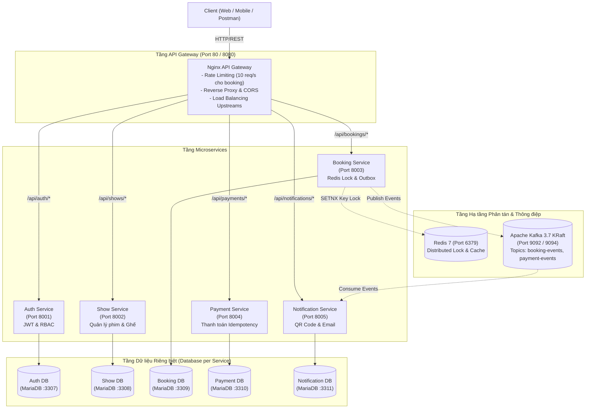

# HỆ THỐNG ĐẶT VÉ TRỰC TUYẾN PHÂN TÁN - HẠ TẦNG DOCKER & NGINX GATEWAY

## 1. Sơ đồ Kiến trúc Phân tán Tổng thể



---

## 2. Bảng Danh mục Cổng & Tài nguyên (Port Matrix)

| Thành phần | Loại dịch vụ | Port Host | Port Container | Ghi chú & Cấu hình |
| :--- | :--- | :---: | :---: | :--- |
| **api-gateway** | Nginx Reverse Proxy | **80, 8080** | 80 | Single Entry Point, Rate Limit: `booking_limit: 10r/s`, `auth_limit: 5r/s` |
| **auth-service** | Node.js Express | **8001** | 8001 | Cấp phát & kiểm tra JWT Token |
| **show-service** | Node.js Express | **8002** | 8002 | CRUD phim, suất chiếu, sơ đồ ma trận ghế 5x8 |
| **booking-service** | Node.js Express | **8003** | 8003 | Đặt vé, kết nối Redis Lock, bảng Outbox |
| **payment-service** | Node.js Express | **8004** | 8004 | Thanh toán giả lập, cơ chế Idempotency |
| **notification-service** | Node.js Express | **8005** | 8005 | Sinh mã QR Code vé, gửi thông báo |
| **auth-db** | MariaDB 10.11 | **3307** | 3306 | DB riêng cho Auth (`auth_db`) |
| **show-db** | MariaDB 10.11 | **3308** | 3306 | DB riêng cho Show (`show_db`) |
| **booking-db** | MariaDB 10.11 | **3309** | 3306 | DB riêng cho Booking (`booking_db`) |
| **payment-db** | MariaDB 10.11 | **3310** | 3306 | DB riêng cho Payment (`payment_db`) |
| **notification-db** | MariaDB 10.11 | **3311** | 3306 | DB riêng cho Notification (`notification_db`) |
| **redis** | Redis 7 Alpine | **6379** | 6379 | Distributed Lock (`SETNX`, TTL) |
| **kafka** | Apache Kafka 3.7 | **9092, 9094** | 9092, 9094 | Chế độ KRaft không cần Zookeeper, tiết kiệm RAM |

---

## 3. Cấu hình Nginx API Gateway Chi tiết

Tệp cấu hình: [`gateway/nginx.conf`](file:///d:/github/UDPT_14/gateway/nginx.conf)
- **Rate Limiting:**
  - `limit_req_zone $binary_remote_addr zone=booking_limit:10m rate=10r/s;` (Chống spam/bot vét vé)
  - `limit_req_zone $binary_remote_addr zone=auth_limit:10m rate=5r/s;` (Chống brute-force mật khẩu)
  - `limit_req_zone $binary_remote_addr zone=general_limit:10m rate=50r/s;`
  - Mã lỗi trả về khi bị block: `429 Too Many Requests`.
- **Upstream Load Balancing:**
  - Cấu hình thuật toán `least_conn` và `keepalive 32` tới 5 cụm service nội bộ trong mạng Docker `cinema-network`.
- **CORS Headers:** Đã cấu hình mở tự động cho Client kết nối an toàn.

---

## 4. Hướng dẫn Khởi chạy Hệ thống

### Bước 1: Bật Docker Desktop trên máy
Mở ứng dụng **Docker Desktop** từ Start Menu hoặc Desktop và chờ thông báo *"Engine running"*.

### Bước 2: Khởi chạy cụm hạ tầng
Chạy lệnh sau tại thư mục gốc dự án:
```powershell
docker compose up -d --build
```

### Bước 3: Kiểm tra trạng thái các container
```powershell
docker compose ps
```

### Bước 4: Chạy script kiểm tra sức khỏe
```powershell
powershell -ExecutionPolicy Bypass -File ./scripts/test-infra.ps1
```

Hoặc kiểm tra thủ công qua cURL/Trình duyệt:
- **Kiểm tra Gateway:** `http://localhost/health`
- **Kiểm tra Auth Service:** `http://localhost/api/auth/health`
- **Kiểm tra Show Service:** `http://localhost/api/shows/health`
- **Xem danh sách phim:** `http://localhost/api/shows/movies`
- **Kiểm tra Booking Service:** `http://localhost/api/bookings/health`
- **Kiểm tra Payment Service:** `http://localhost/api/payments/health`
- **Kiểm tra Notification Service:** `http://localhost/api/notifications/health`
- **Tạo mã QR vé thử nghiệm:** `http://localhost/api/notifications/tickets/TICKET-8888/qr`
