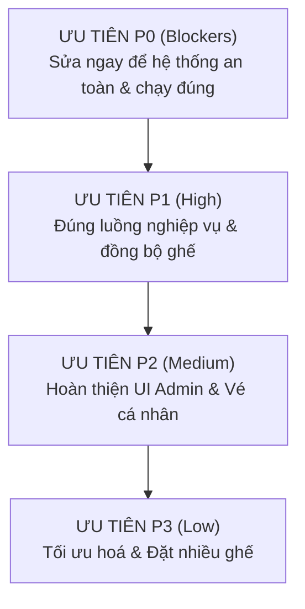

# BÁO CÁO KIỂM TRA ĐỐI CHIẾU FRONTEND - BACKEND (ALIGNMENT AUDIT REPORT)

> **Dự án:** Hệ thống Đặt vé Xem phim Phân tán (Cinema Distributed System)  
> **Ngày thực hiện:** 12/11/2026  
> **Nguyên tắc:** CHỈ ĐỌC và BÁO CÁO (Read-only audit). Mọi phát hiện đều có bằng chứng file và dòng mã cụ thể.  
> **Kiến trúc đích đối chiếu:** Client -> Nginx API Gateway (80/8080) -> 5 Microservices (Auth 8001, Show 8002, Booking 8003, Payment 8004, Notification 8005) + Redis Lock + Kafka + gRPC + Database-per-service.

---

## 1. TÓM TẮT ĐIỀU HÀNH

- **Hiện trạng cấu trúc:** Dự án hiện tồn tại **hai thế giới frontend hoàn toàn tách biệt**:
  1. *Frontend Monolith (Blade Views):* Nằm trong thư mục `resources/views/`, sử dụng Laravel Session Cookie, CSRF Token và Form POST đến các Controller nguyên khối (`app/Http/Controllers/`), ghi trực tiếp vào một cơ sở dữ liệu duy nhất và **hoàn toàn không kết nối tới Nginx Gateway hay 5 Microservices**.
  2. *Frontend SPA Demo:* Nằm tại `gateway/html/index.html` (được Nginx Gateway phục vụ tại cổng 80/8080). Giao diện này đã kết nối trực tiếp đến Gateway và gọi thành công 4 API (`/api/shows/movies`, `/api/shows/showtimes/:id/seats`, `/api/bookings/book`, `/api/notifications/tickets/:id/qr`), chứng minh được tính năng Redis Lock và gRPC nội bộ.
- **Ước lượng tỷ lệ khớp (Alignment Percentage):**
  - **Frontend SPA Demo (`gateway/html/index.html`) vs Microservices:** Khớp khoảng **35%** (chỉ bao phủ luồng đặt vé nhanh và demo tranh chấp ghế; chưa có Auth/JWT, chưa có hiển thị ghế đã bán từ trước, chưa có luồng thanh toán độc lập, thiếu quản trị Admin).
  - **Frontend Blade Monolith vs Microservices:** Khớp **0%** (100% lệch hướng kiến trúc, không gọi qua Gateway, không có JWT).
- **Ba rủi ro kỹ thuật lớn nhất:**
  1. **Lỗ hổng xác thực & định danh (Auth Bypass):** SPA Demo hoàn toàn bỏ qua bước đăng nhập/JWT, hardcode `user_id = 1` và nhận `user_email` tự do từ ô nhập liệu; đồng thời `booking-service` không xác thực token JWT, cho phép bất kỳ ai cũng có thể giả mạo danh tính đặt vé.
  2. **Lệch trạng thái ghế thực tế (Phantom Seat Availability):** `show-service` trả về sơ đồ 40 ghế tĩnh mà không truy vấn trạng thái đã bán từ `booking-service`, dẫn đến việc người dùng vào sau luôn thấy ghế hiển thị màu xám (trống) dù ghế đó đã được mua thành công.
  3. **Gộp tắt luồng Giữ chỗ - Thanh toán (No Two-Phase Hold):** Hệ thống không thực hiện luồng giữ chỗ 2 giai đoạn (`PENDING` kèm `expires_at` -> thanh toán có `Idempotency-Key` -> `CONFIRMED`), mà gộp chung toàn bộ vào một lệnh gọi `POST /book` duy nhất, vi phạm quy trình nghiệp vụ bán vé phân tán chuẩn.

---

## 2. BẢNG ENDPOINT ĐỐI CHIẾU

*Ghi chú trạng thái:*
- **Khớp:** URL, Method, và chức năng cơ bản tương thích.
- **Lệch:** Có kết nối nhưng sai lệch về trường dữ liệu, thiếu header, hoặc sai logic nghiệp vụ.
- **Thiếu FE:** Backend microservice đã cung cấp endpoint nhưng frontend chưa có màn hình/giao diện gọi.
- **Thiếu BE:** Frontend gửi yêu cầu hoặc mong muốn tính năng nhưng Backend không hỗ trợ endpoint tương ứng.

| STT | Frontend Route / Action / Fetch | Backend Endpoint (Microservices / Gateway) | Method | Trạng thái | Chi tiết khác biệt & Bằng chứng mã nguồn |
| :---: | :--- | :--- | :---: | :---: | :--- |
| **I** | **Nhóm Auth & User** | | | | |
| 1 | Chưa có trên SPA Demo.<br>*(Blade: `POST /register`)* | `/api/auth/register`<br>*(Auth Service:8001)* | `POST` | **Thiếu FE** | Backend có `POST /register` (`services/auth-service/server.js:124-156`), nhận `{name, email, password}` trả về JWT. SPA Demo không có màn hình đăng ký. |
| 2 | Chưa có trên SPA Demo.<br>*(Blade: `POST /login`)* | `/api/auth/login`<br>*(Auth Service:8001)* | `POST` | **Thiếu FE** | Backend có `POST /login` (`services/auth-service/server.js:161-193`), trả về Bearer JWT token. SPA Demo không có màn hình đăng nhập, hardcode user. |
| 3 | Chưa có trên cả 2 FE | `/api/auth/verify`<br>*(Auth Service:8001)* | `GET` | **Thiếu FE** | Backend có endpoint xác thực token (`services/auth-service/server.js:198-212`), FE chưa dùng để kiểm tra phiên đăng nhập. |
| 4 | Chưa có trên SPA Demo.<br>*(Blade: `GET /profile`)* | `/api/auth/profile`<br>*(Auth Service:8001)* | `GET` | **Thiếu FE** | Backend yêu cầu Bearer JWT (`services/auth-service/server.js:217-225`). SPA Demo chưa có trang hồ sơ cá nhân. |
| 5 | Chưa có trên SPA Demo.<br>*(Blade: `GET /admin/users`)* | `/api/auth/users`<br>*(Auth Service:8001)* | `GET` | **Thiếu FE** | Backend RBAC chỉ cho phép Admin (`services/auth-service/server.js:230-237`). SPA Demo không có trang quản trị người dùng. |
| 6 | Chưa có trên cả 2 FE | `/api/auth/users/:id/role`<br>*(Auth Service:8001)* | `PATCH` | **Thiếu FE** | Backend hỗ trợ nâng/hạ quyền admin (`services/auth-service/server.js:242-254`). Chưa có UI gọi endpoint này. |
| **II**| **Nhóm Phim & Suất Chiếu (Show)** | | | | |
| 7 | SPA Demo: `fetch('/api/shows/movies')`<br>(`gateway/html/index.html:178`) | `/api/shows/movies`<br>*(Show Service:8002)* | `GET` | **Khớp** | Trả về `{success: true, data: [...]}` (`services/show-service/server.js:230-237`). SPA Demo render thẻ phim đúng danh sách. |
| 8 | Chưa có trên SPA Demo.<br>*(Blade: `POST /admin/movies`)* | `/api/shows/movies`<br>*(Show Service:8002)* | `POST` | **Thiếu FE** | Backend có API tạo phim mới (`services/show-service/server.js:240-254`). SPA Demo chưa có màn hình Admin thêm phim. |
| 9 | Chưa có trên SPA Demo.<br>*(Blade: `GET /movies/{id}`)* | `/api/shows/movies/:id`<br>*(Show Service:8002)* | `GET` | **Thiếu FE** | Backend có API chi tiết phim (`services/show-service/server.js:257-265`). SPA Demo tải toàn bộ danh sách, không gọi chi tiết từng phim. |
| 10 | Chưa có trên SPA Demo.<br>*(Blade: `GET /showtimes`)* | `/api/shows/showtimes`<br>*(Show Service:8002)* | `GET` | **Thiếu FE** | Backend hỗ trợ lọc `?movie_id=` (`services/show-service/server.js:268-284`). SPA Demo đang hardcode `currentShowtimeId = 1` (`gateway/html/index.html:171`). |
| 11 | Chưa có trên SPA Demo.<br>*(Blade: `POST /admin/showtimes`)* | `/api/shows/showtimes`<br>*(Show Service:8002)* | `POST` | **Thiếu FE** | Backend có API tạo suất chiếu (`services/show-service/server.js:287-302`). SPA Demo chưa có form thêm suất chiếu. |
| 12 | SPA Demo: `fetch('/api/shows/showtimes/${id}/seats')`<br>(`gateway/html/index.html:210`) | `/api/shows/showtimes/:id/seats`<br>*(Show Service:8002)* | `GET` | **Lệch** | Backend trả về 40 ghế nhưng không có trường trạng thái `status: 'AVAILABLE'/'SOLD'` (`services/show-service/server.js:305-336`). FE luôn hiển thị tất cả các ghế ở trạng thái trống! |
| **III**| **Nhóm Đặt Vé (Booking)** | | | | |
| 13 | SPA Demo: `fetch('/api/bookings/book')`<br>(`gateway/html/index.html:274-278`) | `/api/bookings/book`<br>*(Booking Service:8003)* | `POST` | **Lệch** | - Payload FE gửi: `{showtime_id, seat_code, user_id, user_email, payment_method}`.<br>- Lệch 1: Không có header `Authorization: Bearer <JWT>`.<br>- Lệch 2: Không có header `Idempotency-Key`.<br>- Lệch 3: Backend xử lý gộp thanh toán và chuyển `CONFIRMED` ngay thay vì giữ chỗ `PENDING` (`services/booking-service/server.js:243-359`). |
| 14 | Blade Monolith: `action="{{ route('movies.book.store') }}"`<br>(`resources/views/client/movies/book.blade.php:69`) | Monolith Route (Web)<br>`POST /movies/{id}/book` | `POST` | **Lệch (Monolith)** | Gửi field `seats: "A1, B2"`, controller xử lý PHP array in-memory (`app/Http/Controllers/BookingController.php:40-84`), không qua Gateway, không Redis Lock. |
| 15 | Chưa có trên SPA Demo.<br>*(Blade: `GET /bookings`)* | `/api/bookings/my-bookings`<br>*(Booking Service:8003)* | `GET` | **Thiếu FE** | Backend có API xem danh sách vé của tôi (`services/booking-service/server.js:375-383`). SPA Demo chưa có màn hình lịch sử vé. |
| 16 | Chưa có trên SPA Demo.<br>*(Blade: `GET /bookings/{id}`)* | `/api/bookings/:id`<br>*(Booking Service:8003)* | `GET` | **Thiếu FE** | Backend có API tra cứu vé theo ID UUID (`services/booking-service/server.js:385-393`). SPA Demo chỉ hiển thị vé vừa đặt qua state RAM. |
| 17 | Chưa có trên SPA Demo.<br>*(Blade: `DELETE /bookings/{id}`)* | `/api/bookings/:id`<br>*(Booking Service:8003)* | `DELETE` | **Thiếu FE** | Backend có API hủy vé và giải phóng Redis Lock (`services/booking-service/server.js:395-410`). SPA Demo chưa có nút Hủy vé. |
| **IV**| **Nhóm Thanh Toán (Payment)** | | | | |
| 18 | SPA Demo chọn Dropdown `payment-method` gửi vào `POST /book` | `/api/payments/*` | `POST` | **Thiếu BE** | Backend Payment Service chỉ có gRPC nội bộ (`services/payment-service/server.js:79-126`) và REST `GET /transactions/:booking_id` (`:189-197`). **Không có REST endpoint `POST /api/payments/process`** để Client gọi trực tiếp qua Gateway. |
| 19 | Chưa có trên cả 2 FE | `/api/payments/transactions/:booking_id`<br>*(Payment Service:8004)* | `GET` | **Thiếu FE** | Backend hỗ trợ tra cứu hóa đơn giao dịch (`services/payment-service/server.js:189-197`), FE chưa tích hợp màn hình xem biên lai giao dịch. |
| **V** | **Nhóm Thông Báo & Vé (Notification)** | | | | |
| 20 | SPA Demo: `fetch('/api/notifications/tickets/${id}/qr')`<br>(`gateway/html/index.html:317`) | `/api/notifications/tickets/:code/qr`<br>*(Notification Service:8005)* | `GET` | **Khớp (Một phần)** | Backend trả về base64 ảnh QR (`services/notification-service/server.js:154-170`), SPA hiển thị vào thẻ `` (`gateway/html/index.html:319`). Tuy nhiên API này sinh QR tĩnh từ chuỗi param, không đọc từ DB `notification_logs`. |
| 21 | Chưa có trên cả 2 FE | `/api/notifications/logs`<br>*(Notification Service:8005)* | `GET` | **Thiếu FE** | Backend có API lấy 50 log email/thông báo gần nhất (`services/notification-service/server.js:173-180`). FE chưa có trang nhật ký thông báo cho Admin. |
| **VI**| **Nhóm Giám Sát Hệ Thống (Health Check)** | | | | |
| 22 | Các Badge trạng thái trên Header SPA Demo (`gateway/html/index.html:34-46`) | `/health`<br>*(Gateway & 5 Services)* | `GET` | **Lệch** | Nginx Gateway có `/health` (`gateway/nginx.conf:106-110`) và cả 5 services đều có `/health` chi tiết DB, Redis, Kafka, Circuit Breaker (`booking-service:201`, `auth-service:101`...). Nhưng SPA Demo chỉ vẽ tĩnh các badge HTML màu mè mà không gọi fetch `/health` định kỳ! |

---

## 3. DANH SÁCH VẤN ĐỀ PHÁT HIỆN

### ALN-001: Frontend Blade Monolith bị ngắt kết nối hoàn toàn khỏi Kiến trúc Microservices
- **Mức độ:** Blocker
- **Nhóm kiểm tra:** Nhóm 1 (Route & Gateway), Nhóm 3 (Xác thực & Phân quyền)
- **Vị trí FE:** [resources/views/client/movies/book.blade.php:69-72](file:///d:/github/UDPT_14/resources/views/client/movies/book.blade.php#L69-L72), [resources/views/auth/login.blade.php:5-6](file:///d:/github/UDPT_14/resources/views/auth/login.blade.php#L5-L6)
- **Vị trí BE:** [gateway/nginx.conf:87-219](file:///d:/github/UDPT_14/gateway/nginx.conf#L87-L219), [docker-compose.yml:328-345](file:///d:/github/UDPT_14/docker-compose.yml#L328-L345)
- **Mô tả hiện tượng:**
  Toàn bộ giao diện Blade trong `resources/views/` sử dụng thẻ form truyền thống (`<form method="POST" action="{{ route('...') }}">`), CSRF token `@csrf`, cơ chế session cookie của Laravel monolith. Khi chạy bằng `docker-compose up`, container Nginx Gateway chỉ phục vụ thư mục `gateway/html/index.html` tại cổng 80/8080. Ứng dụng PHP/Laravel Monolith thậm chí **không có container trong `docker-compose.yml`**. Nếu khởi chạy `php artisan serve` riêng, toàn bộ dữ liệu chỉ ghi vào cơ sở dữ liệu cũ, không hề đi qua Nginx Gateway, không sử dụng Redis Lock, Kafka hay gRPC.
- **Hệ quả thực tế:**
  Hệ thống Blade views hiện tại là "dead frontend" đối với kiến trúc Microservices phân tán; người dùng sử dụng giao diện này sẽ không được hưởng lợi từ khả năng chịu tải, chống race condition hay tính nhất quán của hệ thống phân tán.
- **Đề xuất khắc phục:**
  1. Xác định `gateway/html/index.html` (hoặc nâng cấp thành một ứng dụng SPA React/Vue/Vite) là Frontend chính thức duy nhất của hệ thống Microservices.
  2. Toàn bộ các tương tác chuyển hướng và submit form phải được chuyển sang gọi `fetch()` hoặc `axios()` tới tiền tố `/api/*` của Nginx Gateway.

---

### ALN-002: SPA Demo thiếu hoàn toàn Module Xác thực JWT và Phân quyền RBAC
- **Mức độ:** Blocker
- **Nhóm kiểm tra:** Nhóm 3 (Xác thực và phân quyền)
- **Vị trí FE:** [gateway/html/index.html:116-119](file:///d:/github/UDPT_14/gateway/html/index.html#L116-L119), [gateway/html/index.html:265-271](file:///d:/github/UDPT_14/gateway/html/index.html#L265-L271)
- **Vị trí BE:** [services/auth-service/server.js:69-84](file:///d:/github/UDPT_14/services/auth-service/server.js#L69-L84), [services/booking-service/server.js:244-252](file:///d:/github/UDPT_14/services/booking-service/server.js#L244-L252)
- **Mô tả hiện tượng:**
  - `auth-service` đã triển khai đầy đủ cơ chế cấp phát JWT và kiểm tra token (`authenticateToken`, `requireRole`), yêu cầu header `Authorization: Bearer <token>`.
  - Nhưng trên giao diện SPA Demo (`index.html`), không có màn hình Đăng ký / Đăng nhập. Thông tin người dùng bị hardcode trực tiếp:
    ```javascript
    const payload = {
        showtime_id: currentShowtimeId,
        seat_code: selectedSeat.code,
        user_id: 1, // Hardcode user_id
        user_email: document.getElementById('user-email').value, // Lấy từ input tự do
        payment_method: document.getElementById('payment-method').value
    };
    ```
  - Phía `booking-service` cũng không xác thực JWT, chỉ lấy `user_id || 1` từ request body:
    ```javascript
    const currentUserId = user_id || 1;
    ```
- **Hệ quả thực tế:**
  Mọi người dùng đều có thể mạo danh bất kỳ ai chỉ bằng cách gõ email khác vào ô input. Toàn bộ hệ thống xác thực Auth Service và tính năng phân quyền RBAC bị vô hiệu hóa hoàn toàn trong luồng người dùng thực tế.
- **Đề xuất khắc phục:**
  1. Thêm modal hoặc trang Đăng nhập / Đăng ký trên SPA Demo, gọi `POST /api/auth/login`, nhận JWT token và lưu vào `localStorage.getItem('token')`.
  2. Gắn header `Authorization: Bearer ${token}` vào tất cả các request gửi đến Gateway (`/api/bookings/*`, `/api/auth/profile`).
  3. Bổ sung middleware xác thực JWT trong `booking-service` để giải mã `user_id` và `email` từ token thay vì tin tưởng payload gửi từ client.

---

### ALN-003: Sơ đồ ghế không phản ánh trạng thái đã bán từ Cơ sở dữ liệu Booking
- **Mức độ:** Cao
- **Nhóm kiểm tra:** Nhóm 2 (Hợp đồng dữ liệu), Nhóm 4 (Luồng đặt vé và tranh chấp ghế)
- **Vị trí FE:** [gateway/html/index.html:208-238](file:///d:/github/UDPT_14/gateway/html/index.html#L208-L238)
- **Vị trí BE:** [services/show-service/server.js:305-336](file:///d:/github/UDPT_14/services/show-service/server.js#L305-L336), [services/booking-service/server.js:278-285](file:///d:/github/UDPT_14/services/booking-service/server.js#L278-L285)
- **Mô tả hiện tượng:**
  - Endpoint `GET /api/shows/showtimes/:id/seats` của `show-service` chỉ tạo ra một danh sách ghế tĩnh (hàng A-E, cột 1-8 = 40 ghế) kèm giá tiền, mà **không hề chứa trường `status`** (AVAILABLE, LOCKED, SOLD).
  - Vì vậy, hàm `loadSeatMap()` trên FE luôn render tất cả 40 ghế màu xám (sẵn sàng chọn).
  - Khi một người dùng mới mở trình duyệt hoặc F5 tải lại trang, những ghế đã được người khác mua thành công (lưu trong `booking_db.bookings` với trạng thái `CONFIRMED`) vẫn hiển thị là ghế trống! Chỉ đến khi người dùng bấm nút "XÁC NHẬN ĐẶT VÉ", backend mới trả về lỗi `HTTP 409 SEAT_ALREADY_SOLD`.
- **Hệ quả thực tế:**
  Trải nghiệm người dùng bị đánh lừa; người dùng liên tục bấm chọn vào các ghế tưởng như còn trống nhưng thực tế đã có người mua từ trước.
- **Đề xuất khắc phục:**
  1. Hợp đồng dữ liệu: Sửa API `GET /api/shows/showtimes/:id/seats` (hoặc `GET /api/bookings/showtimes/:id/occupied-seats`) để trả về danh sách các ghế đã bán / đang khóa:
     ```json
     {
       "code": "A1",
       "type": "STANDARD",
       "price": 85000,
       "status": "SOLD" // hoặc "AVAILABLE", "LOCKED"
     }
     ```
  2. Trên FE `loadSeatMap()`: Nếu `seat.status === 'SOLD'`, tự động thêm class `seat-sold`, hiển thị chữ 'X' và disable sự kiện click.

---

### ALN-004: Gộp tắt luồng Giữ chỗ 2 giai đoạn và thiếu Đếm ngược Hết hạn (expires_at)
- **Mức độ:** Cao
- **Nhóm kiểm tra:** Nhóm 4 (Luồng đặt vé), Nhóm 6 (Bất đồng bộ)
- **Vị trí FE:** [gateway/html/index.html:255-305](file:///d:/github/UDPT_14/gateway/html/index.html#L255-L305)
- **Vị trí BE:** [services/booking-service/server.js:243-359](file:///d:/github/UDPT_14/services/booking-service/server.js#L243-L359)
- **Mô tả hiện tượng:**
  Theo kiến trúc đích chuẩn:
  *Bước 1:* Chọn ghế -> Giữ chỗ (Tạo booking trạng thái `PENDING`, thiết lập Redis Lock có TTL 300s, trả về `expires_at`).
  *Bước 2:* UI hiển thị đồng hồ đếm ngược 5 phút (300s), người dùng thực hiện thanh toán.
  *Bước 3:* Nhận kết quả thanh toán -> Xác nhận `CONFIRMED` hoặc Hủy/Timeout thì nhả ghế (`CANCELLED`/`EXPIRED`).
  
  Hiện tại: Backend `booking-service` gộp toàn bộ các bước vào một hàm `POST /book`:
  - Giữ Redis Lock 300s (`line 257`)
  - Gọi gRPC sang Show kiểm tra (`line 268`)
  - Gọi gRPC sang Payment thanh toán giả lập ngay lập tức (`line 290`)
  - Ghi DB `status = "CONFIRMED"` (`line 304`)
  Toàn bộ quá trình diễn ra đồng bộ trong vài chục mili-giây. Frontend không hề có trạng thái chờ thanh toán `PENDING`, không có đồng hồ đếm ngược thời gian giữ ghế.
- **Hệ quả thực tế:**
  Hệ thống không mô phỏng đúng kịch bản người dùng chuyển sang cổng thanh toán (VNPAY/MOMO) rồi hủy giao dịch hoặc để hết hạn thanh toán.
- **Đề xuất khắc phục:**
  1. Tách `booking-service` thành 2 endpoint:
     - `POST /api/bookings/hold`: Giữ chỗ, lưu DB `status = 'PENDING'`, trả về `{ booking_id, expires_at: 300 }`.
     - `POST /api/bookings/confirm-payment`: Nhận thông tin thanh toán, chuyển `status = 'CONFIRMED'`.
  2. Bổ sung đồng hồ đếm ngược (Countdown Timer) 300s trên UI; nếu hết giờ mà chưa thanh toán, tự động gọi API nhả ghế và reset sơ đồ.

---

### ALN-005: Thiếu Header Idempotency-Key trong Giao dịch Đặt vé & Thanh toán
- **Mức độ:** Cao
- **Nhóm kiểm tra:** Nhóm 2 (Hợp đồng dữ liệu), Nhóm 5 (Thanh toán)
- **Vị trí FE:** [gateway/html/index.html:274-278](file:///d:/github/UDPT_14/gateway/html/index.html#L274-L278)
- **Vị trí BE:** [services/payment-service/server.js:80-96](file:///d:/github/UDPT_14/services/payment-service/server.js#L80-L96)
- **Mô tả hiện tượng:**
  - `payment-service` có logic kiểm tra trùng lặp thông qua `booking_id` (`services/payment-service/server.js:84`):
    ```javascript
    const [existing] = await pool.query('SELECT * FROM transactions WHERE booking_id = ?', [booking_id]);
    ```
  - Tuy nhiên, Frontend SPA Demo khi gọi đặt vé lại không hề sinh và truyền header `Idempotency-Key` (ví dụ UUIDv4 ngẫu nhiên cho mỗi phiên bấm nút):
    ```javascript
    const res = await fetch('/api/bookings/book', {
        method: 'POST',
        headers: { 'Content-Type': 'application/json' }, // Thiếu Idempotency-Key
        body: JSON.stringify(payload)
    });
    ```
- **Hệ quả thực tế:**
  Nếu mạng bị chập chờn (timeout ở tầng Gateway) khiến client gửi lại (retry) một request đặt vé mới, backend sẽ coi đó là một lượt đặt vé mới hoặc xảy ra lỗi tranh chấp khóa.
- **Đề xuất khắc phục:**
  1. Frontend sinh mã UUID khi mở form thanh toán và gửi kèm trong header: `Idempotency-Key: <client-generated-uuid>`.
  2. API Gateway và Booking/Payment Service kiểm tra và lưu cache Idempotency-Key trong Redis để đảm bảo nếu gửi trùng key sẽ trả về kết quả cũ ngay lập tức mà không thực hiện trừ tiền lặp lại.

---

### ALN-006: Backend Payment Service thiếu REST API công khai cho Gateway
- **Mức độ:** Trung bình
- **Nhóm kiểm tra:** Nhóm 1 (Route & Gateway), Nhóm 5 (Thanh toán)
- **Vị trí FE:** [gateway/html/index.html:121-127](file:///d:/github/UDPT_14/gateway/html/index.html#L121-L127)
- **Vị trí BE:** [gateway/nginx.conf:180-192](file:///d:/github/UDPT_14/gateway/nginx.conf#L180-L192), [services/payment-service/server.js:163-197](file:///d:/github/UDPT_14/services/payment-service/server.js#L163-L197)
- **Mô tả hiện tượng:**
  - Trong `gateway/nginx.conf`, có định tuyến upstream `/api/payments/` chuyển tiếp đến `payment-service:8004`.
  - Nhưng trong `services/payment-service/server.js`, các endpoint REST duy nhất chỉ là:
    - `GET /health` (`line 167`)
    - `GET /transactions/:booking_id` (`line 189`)
  - Chức năng thanh toán cốt lõi `ProcessPayment` chỉ được cung cấp qua cổng gRPC 50052 cho `booking-service` gọi nội bộ. Payment Service **không hề có endpoint REST `POST /transactions` hay `POST /process`**.
- **Hệ quả thực tế:**
  Khách hàng/Frontend không thể chủ động gọi thanh toán trực tiếp qua API Gateway; bắt buộc toàn bộ luồng thanh toán phải ủy thác gián tiếp qua `booking-service`.
- **Đề xuất khắc phục:**
  Bổ sung REST endpoint `POST /process` vào `payment-service` với các tham số `{ booking_id, user_id, amount, payment_method }`, hỗ trợ header `Idempotency-Key`, để Client có thể gọi thanh toán độc lập sau khi đã giữ chỗ thành công.

---

### ALN-007: Khiếm khuyết trong Cơ chế Render QR Code và Tính Bất đồng bộ Kafka
- **Mức độ:** Trung bình
- **Nhóm kiểm tra:** Nhóm 6 (Bất đồng bộ và nhất quán cuối cùng)
- **Vị trí FE:** [gateway/html/index.html:317-319](file:///d:/github/UDPT_14/gateway/html/index.html#L317-L319)
- **Vị trí BE:** [services/notification-service/server.js:73-120](file:///d:/github/UDPT_14/services/notification-service/server.js#L73-L120), [services/notification-service/server.js:154-170](file:///d:/github/UDPT_14/services/notification-service/server.js#L154-L170)
- **Mô tả hiện tượng:**
  - Trong kiến trúc chuẩn, sau khi `booking-service` ghi vé và bắn sự kiện qua Kafka `booking-events`, `notification-service` tiêu thụ sự kiện này, sinh ảnh QR Code chứa đầy đủ thông tin vé và lưu vào cơ sở dữ liệu `notification_logs` (cột `qr_code_data`).
  - Tuy nhiên, trên FE SPA Demo, sau khi nhận kết quả `POST /book`, client ngay lập tức gọi:
    ```javascript
    const qrRes = await fetch(`/api/notifications/tickets/${booking.id}/qr`);
    const qrData = await qrRes.json();
    document.getElementById('ticket-qr').src = qrData.qr_image_base64;
    ```
  - Tại `notification-service`, endpoint `GET /tickets/:code/qr` lại tự sinh mã QR on-the-fly từ chuỗi `:code` truyền trên URL, **hoàn toàn không kiểm tra xem Kafka consumer đã xử lý xong message hay chưa, cũng không đọc từ database `notification_logs`**.
- **Hệ quả thực tế:**
  Việc hiển thị mã QR trên FE không phản ánh đúng trạng thái hoàn tất xử lý bất đồng bộ của Kafka Consumer. Nếu Kafka bị nghẽn (lag), FE vẫn hiển thị QR mã hóa chuỗi ID thô thay vì QR đầy đủ thông tin vé từ Kafka event.
- **Đề xuất khắc phục:**
  1. Sửa API `GET /api/notifications/tickets/:id` để truy vấn từ bảng `notification_logs` theo `booking_id`.
  2. Trên Frontend, thực hiện cơ chế polling nhẹ (ví dụ thử lại tối đa 3 lần cách nhau 1 giây) để chờ Kafka Consumer lưu vé thành công, thể hiện đúng tính nhất quán cuối cùng (Eventual Consistency).

---

### ALN-008: Bỏ sót Giao diện Quản trị (Admin) và Lịch sử Vé của Người dùng
- **Mức độ:** Trung bình
- **Nhóm kiểm tra:** Nhóm 8 (Chức năng backend chưa có giao diện)
- **Vị trí FE:** [gateway/html/index.html:1-368](file:///d:/github/UDPT_14/gateway/html/index.html#L1-L368)
- **Vị trí BE:** [services/booking-service/server.js:375-410](file:///d:/github/UDPT_14/services/booking-service/server.js#L375-L410), [services/show-service/server.js:239-302](file:///d:/github/UDPT_14/services/show-service/server.js#L239-L302), [services/auth-service/server.js:230-254](file:///d:/github/UDPT_14/services/auth-service/server.js#L230-L254)
- **Mô tả hiện tượng:**
  Backend Microservices đã xây dựng sẵn hàng loạt endpoint phục vụ quản trị và xem dữ liệu cá nhân:
  - `GET /api/bookings/my-bookings`: Danh sách vé đã đặt của khách.
  - `DELETE /api/bookings/:id`: Hủy vé.
  - `POST /api/shows/movies`: Tạo phim mới (Admin).
  - `POST /api/shows/showtimes`: Thêm suất chiếu (Admin).
  - `GET /api/auth/users`: Quản lý danh sách tài khoản (Admin).
  - `PATCH /api/auth/users/:id/role`: Phân quyền người dùng (Admin).
  - `GET /api/notifications/logs`: Xem lịch sử gửi vé và thông báo (Admin).
  Tuy nhiên, SPA Demo chỉ có duy nhất một màn hình đặt vé trực quan cho 1 phim; không có tab hay trang con nào để người dùng quản lý vé của mình hoặc để Admin thao tác nghiệp vụ.
- **Hệ quả thực tế:**
  Hơn 60% năng lực API của các Microservices bị "bỏ quên", không thể demo hoặc kiểm thử từ giao diện người dùng nếu không dùng công cụ như Postman/curl.
- **Đề xuất khắc phục:**
  Bổ sung giao diện Tab trên SPA Demo:
  - Tab 1: Đặt vé trực quan (hiện tại).
  - Tab 2: Vé của tôi (`GET /api/bookings/my-bookings`, nút Hủy vé `DELETE`).
  - Tab 3: Bảng điều khiển Quản trị (CRUD Phim, Suất chiếu, Phân quyền User, Logs Kafka).

---

### ALN-009: Lệch Hợp đồng Dữ liệu Đặt Ghế Đơn lẻ vs Nhiều Ghế đồng thời
- **Mức độ:** Thấp
- **Nhóm kiểm tra:** Nhóm 2 (Hợp đồng dữ liệu)
- **Vị trí FE:** [resources/views/client/movies/book.blade.php:72](file:///d:/github/UDPT_14/resources/views/client/movies/book.blade.php#L72), [gateway/html/index.html:267](file:///d:/github/UDPT_14/gateway/html/index.html#L267)
- **Vị trí BE:** [services/booking-service/server.js:244](file:///d:/github/UDPT_14/services/booking-service/server.js#L244)
- **Mô tả hiện tượng:**
  - Trên giao diện Blade cũ (`book.blade.php`), người dùng được phép chọn nhiều ghế cùng lúc (`selectedSeats = ['A1', 'A2']`), truyền vào form input dạng chuỗi nối dấu phẩy: `seats = "A1, A2"`.
  - Trên SPA Demo (`index.html`), FE chỉ cho phép chọn đúng 1 ghế duy nhất (`selectedSeat = seat`), gửi lên payload trường `seat_code: "A1"`.
  - Phía backend `booking-service` cũng chỉ nhận duy nhất một trường chuỗi đơn `seat_code` và thiết lập khóa Redis cho 1 ghế đó (`lockKey = lock:show:${showtime_id}:seat:${cleanSeat}`).
- **Hệ quả thực tế:**
  Khách hàng không thể đặt vé cho cặp đôi hoặc gia đình (đặt 2-4 ghế cùng lúc trong một giao dịch). Nếu muốn mua 3 vé, khách phải bấm thanh toán 3 lần riêng biệt.
- **Đề xuất khắc phục:**
  1. Nâng cấp API `booking-service` để chấp nhận mảng `seat_codes: ["A1", "A2"]`.
  2. Sử dụng Redis Multi-key Lock (hoặc Redlock) để khóa đồng thời tất cả các ghế được yêu cầu trong một transaction nguyên tử, tránh tình trạng khóa được ghế này nhưng trượt ghế kia.

---

## 4. MA TRẬN LUỒNG ĐẶT VÉ (BOOKING FLOW MATRIX)

| Bước trong Luồng chuẩn | Kỳ vọng Kiến trúc Đích | Hiện trạng Frontend (SPA Demo & Blade) | Hiện trạng Backend Microservices | Đánh giá Mức độ Khớp |
| :--- | :--- | :--- | :--- | :---: |
| **1. Đăng nhập / Xác thực** | Đăng nhập bằng email/pass, nhận JWT Bearer token có hạn 24h, lưu client storage. Gửi kèm header `Authorization` cho mọi request sau. | - SPA Demo: Bỏ qua 100%, không form đăng nhập, hardcode `user_id: 1`.<br>- Blade: Dùng session cookie & CSRF Laravel, không có JWT. | `auth-service` có đầy đủ `POST /login`, `POST /register`, JWT verification & RBAC. | **KHÔNG KHỚP** *(0%)* |
| **2. Xem danh sách Phim & Suất chiếu** | Lấy danh sách phim động qua `/api/shows/movies`. Lọc suất chiếu theo phim qua `/api/shows/showtimes?movie_id=X`. | - SPA Demo: Gọi `GET /api/shows/movies` thành công. Suất chiếu bị hardcode ID = 1.<br>- Blade: Server-side Eloquent Model. | `show-service` cung cấp đầy đủ cả `GET /movies` và `GET /showtimes?movie_id=X`. | **KHỚP MỘT PHẦN** *(60%)* |
| **3. Xem sơ đồ ghế & Trạng thái** | Lấy danh sách ghế qua `/api/shows/showtimes/:id/seats`. Hiển thị rõ: ghế trống, ghế VIP, ghế đang bị giữ, ghế đã bán. | - SPA Demo: Gọi API lấy 40 ghế, nhưng tất cả ghế đều hiện màu xám (trống) vì API không trả trạng thái đã bán.<br>- Blade: Lấy mảng ghế đã bán từ database monolith. | `show-service` chỉ sinh mảng 40 ghế tĩnh kèm loại ghế & giá, không kiểm tra trạng thái từ `booking_db`. | **LỆCH HỢP ĐỒNG** *(40%)* |
| **4. Chọn ghế & Giữ chỗ (Hold)** | Bấm chọn ghế -> Gửi `POST /api/bookings/hold` -> Backend lấy Redis Lock (TTL 300s), tạo booking `PENDING` -> Trả về `expires_at` -> FE đếm ngược 5 phút. | - SPA Demo: Không có bước giữ chỗ riêng; bấm nút là thanh toán và chốt vé ngay lập tức. Không có đếm ngược.<br>- Blade: Submit form lưu trực tiếp. | `booking-service` có Redis Lock (`SETNX 300s`), nhưng không trả trạng thái `PENDING` về FE mà tự động gọi gRPC thanh toán ngay. | **GỘP BƯỚC / THIẾU FLOW** *(30%)* |
| **5. Thanh toán (Payment)** | Chọn phương thức (VNPAY/MOMO) -> Gửi header `Idempotency-Key` -> Nhận kết quả thành công/thất bại -> Chuyển trạng thái booking sang `CONFIRMED`. | - SPA Demo: Chọn dropdown VNPAY/MOMO nhưng không gửi `Idempotency-Key`. Gửi gộp trong payload `POST /book`.<br>- Blade: Không có thanh toán online. | `payment-service` có logic Idempotency theo `booking_id` qua gRPC 50052, nhưng không có REST API độc lập cho Client. | **LỆCH HỢP ĐỒNG** *(50%)* |
| **6. Xác nhận vé & Nhận QR qua Kafka** | Nhận phản hồi thành công kèm UUID vé. Kafka đẩy event -> Notification Service sinh QR lưu DB và gửi email -> FE hiển thị vé có ảnh QR thật. | - SPA Demo: Nhận UUID, gọi `GET /api/notifications/tickets/:id/qr`, hiển thị ảnh QR base64 thành công.<br>- Blade: Sinh chuỗi random 8 ký tự, gửi mail đồng bộ. | `booking-service` dùng Transactional Outbox + Kafka `booking-events`. `notification-service` sinh QR và gửi mail thành công. | **KHỚP TỐT** *(80%)* |

---

## 5. DANH SÁCH CHIỀU A & CHIỀU B

### Chiều B: Backend có Endpoint nhưng Frontend chưa dùng (Giao diện còn thiếu)

1. **Auth Service (Port 8001):**
   - `POST /api/auth/register`: Màn hình Đăng ký tài khoản người dùng mới.
   - `POST /api/auth/login`: Màn hình Đăng nhập và lưu JWT.
   - `GET /api/auth/verify`: Hàm kiểm tra tính hợp lệ của token khi tải trang.
   - `GET /api/auth/profile`: Trang thông tin cá nhân của người dùng.
   - `GET /api/auth/users`: Trang quản trị danh sách người dùng (Admin).
   - `PATCH /api/auth/users/:id/role`: Nút phân quyền User <-> Admin (Admin).
2. **Show Service (Port 8002):**
   - `POST /api/shows/movies`: Form tạo phim mới (Admin).
   - `GET /api/shows/movies/:id`: Trang chi tiết từng bộ phim.
   - `GET /api/shows/showtimes`: Bộ lọc chọn suất chiếu linh hoạt theo phim (`?movie_id=`).
   - `POST /api/shows/showtimes`: Form tạo suất chiếu mới cho rạp (Admin).
3. **Booking Service (Port 8003):**
   - `GET /api/bookings/my-bookings`: Màn hình xem danh sách vé đã mua của tài khoản hiện tại.
   - `GET /api/bookings/:id`: Màn hình tra cứu chi tiết 1 vé theo mã UUID.
   - `DELETE /api/bookings/:id`: Nút chức năng "Hủy vé" (hoàn tiền & nhả ghế lại cho người khác).
4. **Payment Service (Port 8004):**
   - `GET /api/payments/transactions/:booking_id`: Màn hình xem biên lai/chi tiết giao dịch thanh toán.
5. **Notification Service (Port 8005):**
   - `GET /api/notifications/logs`: Màn hình xem nhật ký gửi email và vé điện tử (Admin).
6. **Hạ tầng Gateway & Giám sát:**
   - `GET /health`: Widget hiển thị trạng thái sống (UP/DOWN) thời gian thực của Nginx Gateway, Redis, Kafka, DB và Circuit Breaker.

### Chiều A: Frontend gọi vào Endpoint hoặc Hành vi không tồn tại trên Microservices

1. **Blade Monolith Web Actions:**
   - `action="{{ route('movies.book.store', $movie->id) }}"` (`POST /movies/{id}/book`): Gọi vào controller PHP Monolith `BookingController@store`, ghi vào DB cũ, microservice không biết tới request này.
   - `action="{{ route('login') }}"` / `action="{{ route('register') }}"`: Đăng nhập/Đăng ký qua session web Laravel thay vì cấp phát JWT token.
   - `action="{{ route('bookings.destroy', $booking->id) }}"`: Hủy vé trên DB cũ thay vì gọi qua `DELETE /api/bookings/:id`.
2. **SPA Demo Missing Endpoints:**
   - Không có trường hợp gọi vào endpoint bị 404 (cả 4 API SPA Demo gọi đều được Nginx map đúng tới upstream). Tuy nhiên, SPA Demo kỳ vọng `payment_method` gửi vào `POST /api/bookings/book` sẽ xử lý thanh toán, trong khi kiến trúc phân tán chuẩn yêu cầu gọi độc lập tới Payment Service.

---

## 6. PHẦN CHƯA XÁC MINH ĐƯỢC & CÂU HỎI CẦN LÀM RÕ

1. **Định hướng xử lý Frontend Blade:**
   - *Thực tế:* Thư mục `resources/views/` chứa toàn bộ UI cũ viết bằng Laravel Blade phong phú hơn SPA Demo rất nhiều (có đủ trang chủ, chi tiết phim, bình luận, quản trị phim, suất chiếu).
   - *Câu hỏi:* Đồ án dự kiến tiếp tục phát triển giao diện SPA (`gateway/html/index.html` hoặc chuyển sang React/Vue) hay muốn cấu hình lại Laravel Monolith đóng vai trò là Client tiêu thụ API của Microservices (chuyển các Controller Laravel thành API Consumer gọi Gateway bằng Guzzle/Http Client)?
2. **Kịch bản thanh toán thực tế (Real vs Mock Payment):**
   - *Thực tế:* `payment-service` hiện tại là cổng giả lập (luôn trả về `SUCCESS` sau khi ghi log DB).
   - *Câu hỏi:* Khi demo hoặc nghiệm thu, đồ án có yêu cầu tích hợp Sandbox thực tế của VNPAY/MOMO (chuyển hướng người dùng sang trang thanh toán của bên thứ ba rồi nhận Webhook IPN) hay chỉ dừng lại ở Mock Payment Service có kiểm tra Idempotency?
3. **Chính sách phân vùng ghế VIP và định giá:**
   - *Thực tế:* Trong `services/show-service/server.js:321`, hàng ghế E được code cứng là VIP (+15,000 VNĐ). Tuy nhiên trong bảng `showtimes` chỉ lưu một cột `price` duy nhất.
   - *Câu hỏi:* Cần làm rõ logic định giá ghế để frontend và backend có công thức tính tiền hoàn toàn đồng nhất.

---

## 7. THỨ TỰ SỬA ĐỀ XUẤT (PRIORITY ROADMAP)



### [P0] - Ưu tiên khẩn cấp (Sửa ngay để loại bỏ rủi ro bảo mật & hỏng kiến trúc)
1. **Tích hợp JWT Authentication cho SPA Demo (Khắc phục ALN-002):**
   - Thêm modal/form Đăng nhập và Đăng ký trên SPA `index.html`.
   - Gọi `POST /api/auth/login`, nhận token, lưu vào `localStorage`.
   - Gắn header `Authorization: Bearer <token>` vào request đặt vé.
   - Thêm middleware kiểm tra JWT trong `booking-service` để giải mã danh tính thực từ token.
2. **Thống nhất giải pháp Frontend (Khắc phục ALN-001):**
   - Thống nhất không sử dụng form submit session-based của Blade monolith cho các tính năng phân tán; tập trung toàn bộ giao diện vào SPA chạy qua Nginx Gateway cổng 80/8080.

### [P1] - Ưu tiên cao (Đảm bảo đúng nghiệp vụ đặt vé phân tán)
3. **Đồng bộ trạng thái ghế thực tế (Khắc phục ALN-003):**
   - Nâng cấp API `show-service` hoặc tạo endpoint tổng hợp để kiểm tra ghế nào trong suất chiếu đã được mua trong `booking_db`.
   - Cập nhật hàm `loadSeatMap()` trên FE: Đánh dấu đỏ (`seat-sold`), khóa click ngay khi tải trang cho các ghế đã có người mua.
4. **Tách luồng Giữ chỗ 2 giai đoạn & Countdown Timer (Khắc phục ALN-004):**
   - Tách API thành `POST /hold` (trả về trạng thái `PENDING` và thời gian giữ chỗ 300s) và `POST /confirm-payment`.
   - Thêm đồng hồ đếm ngược trực quan 5 phút trên giao diện thanh toán; tự động giải phóng ghế nếu hết thời gian giữ chỗ.
5. **Gắn Header Idempotency-Key (Khắc phục ALN-005):**
   - Client tự động sinh UUID v4 cho mỗi phiên thanh toán, gắn vào header `Idempotency-Key` khi gửi request.

### [P2] - Ưu tiên trung bình (Mở rộng tính năng cho người dùng & Admin)
6. **Bổ sung UI xem lịch sử vé và Hủy vé (Khắc phục ALN-008):**
   - Tạo tab "Vé của tôi": gọi `GET /api/bookings/my-bookings` để hiển thị danh sách vé, kèm nút "Hủy vé" (`DELETE /api/bookings/:id`) giúp nhả ghế về sơ đồ.
7. **Bổ sung Bảng điều khiển Quản trị Admin (Khắc phục ALN-008):**
   - Tạo tab "Quản trị": CRUD Phim, Suất chiếu, Phân quyền tài khoản người dùng, xem danh sách log sự kiện Kafka.
8. **Đồng bộ hóa Polling hiển thị QR Code (Khắc phục ALN-007):**
   - Cho FE thăm dò kết quả từ `notification_logs` để đảm bảo QR Code hiển thị chính xác là kết quả do Kafka Consumer xử lý.

### [P3] - Ưu tiên thấp (Hoàn thiện trải nghiệm & tối ưu hóa)
9. **Hỗ trợ chọn và đặt nhiều ghế cùng lúc (Khắc phục ALN-009):**
   - Cho phép mảng `seat_codes: [...]`, áp dụng Redis Multi-key lock.
10. **Kết nối Widget Giám sát Sức khỏe hệ thống thời gian thực:**
    - Thay thế các badge tĩnh trên Header bằng việc gọi fetch định kỳ tới `/health` của Gateway và hiển thị trạng thái Circuit Breaker thực tế.
